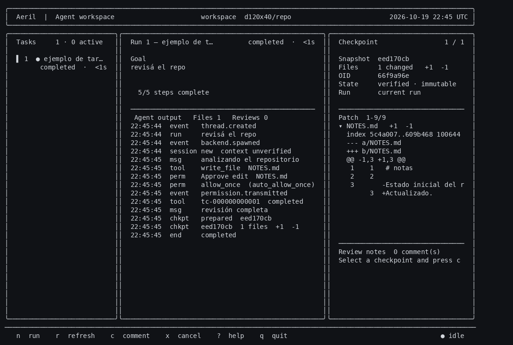
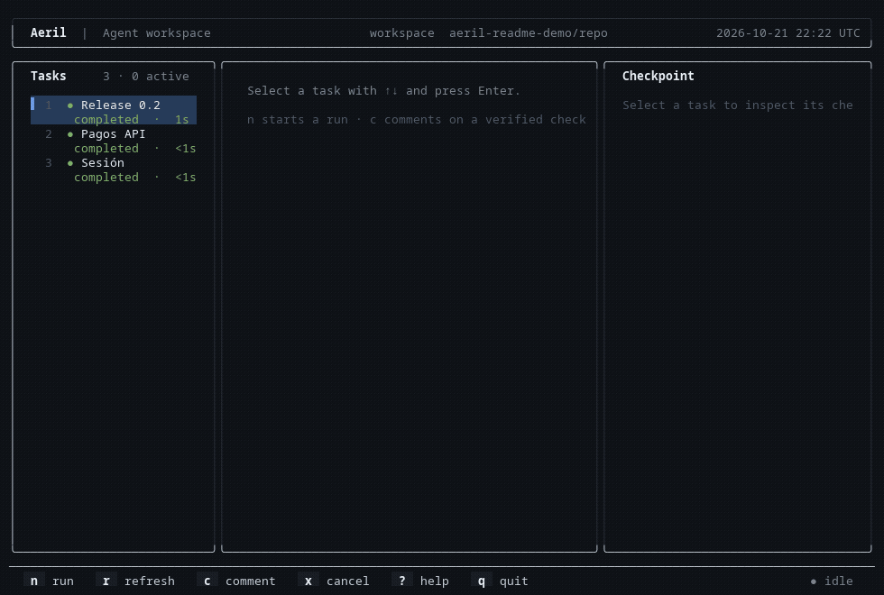

# Aeril

**Un espacio de trabajo de terminal para agentes de código.**

Aeril reúne tareas, ejecuciones de agentes, cambios, checkpoints e historial durable en una sola interfaz. El objetivo es simple: que puedas delegar trabajo sin perder de vista qué pasó, qué se modificó y dónde quedó cada tarea.

Aeril no es otro modelo de IA. Es la capa de trabajo y supervisión para agentes externos como Hermes.



## Cómo funciona



1. **Abrís una tarea.** Cada tarea tiene su propio historial, rama y espacio de trabajo Git.
2. **Lanzás un agente.** Aeril lo supervisa y muestra el objetivo, la actividad y el estado del run.
3. **Revisás el resultado.** Ves el diff, los archivos modificados y el checkpoint verificado antes de integrar nada.
4. **Dejás contexto.** Los comentarios y el feedback quedan asociados al trabajo para la siguiente sesión.
5. **Retomás después.** Si algo se interrumpe, Aeril conserva evidencia durable y puntos de recuperación.

## Qué podés hacer hoy

- **Organizar tareas y threads.** Cada tarea mantiene su propio historial y workspace basado en Git.
- **Ejecutar agentes externos.** La TUI muestra el estado del run, la actividad del agente y los eventos del sistema.
- **Revisar antes de integrar.** Consultá el patch, los archivos modificados y el checkpoint verificado.
- **Comentar y dar feedback.** Las observaciones quedan vinculadas a la tarea y al checkpoint revisado.
- **Recuperar trabajo interrumpido.** Aeril reconcilia runs y checkpoints sin reconstruir el estado desde el working tree actual.
- **Coordinar espacios de trabajo.** Los leases y bloqueos evitan que dos procesos escriban sobre el mismo workspace de forma incompatible.
- **Trabajar con poca memoria.** La TUI está diseñada para un consumo acotado y medible.

La interfaz permite supervisar hasta dos runs mock concurrentes. La ejecución de Hermes real mantiene una restricción de una sesión autenticada por vez.

## Empezar

**Estado actual: versión temprana para desarrolladores.** No hay un instalador universal ni una garantía de funcionamiento en cualquier máquina.

Necesitás Linux, Git, Rust/Cargo y, para ejecutar tareas reales, un agente externo compatible.

```bash
git clone https://github.com/elliotsecops/aeril.git
cd aeril
cargo build --release
./target/release/aeril
```

Ese último comando abre la TUI. Para registrar un proyecto Git desde la CLI:

```bash
./target/release/aeril thread new --repo /ruta/a/tu/proyecto --title "Corregir inicio de sesión"
./target/release/aeril thread list
```

Crear el thread no inicia un agente. Para trabajar con Hermes o con el backend mock de desarrollo, configurá el backend correspondiente.

## Estado actual

Aeril ya incluye la interfaz de terminal, historial de tareas, revisión de cambios, checkpoints, recuperación y coordinación de workspaces. La integración final fue aceptada con **230/230 tests**, repetida tres veces, y los budgets de release pasan.

También está implementada la gestión de perfiles Hermes P2-S1, pero **permanece desactivada por defecto**.

Lo que **no** estamos anunciando como listo:

- Dos sesiones reales y autenticadas de Hermes funcionando simultáneamente. P2-S2 sigue en HOLD.
- Aislamiento completo del resto de los archivos o credenciales del sistema. Aeril separa tareas y workspaces; no es un sandbox del sistema operativo.
- Restauración de la memoria conversacional o del razonamiento privado de un modelo. Los checkpoints recuperan estado verificado del proyecto.
- Compatibilidad certificada con Raspberry Pi, Termux o cualquier proveedor de VPS.
- Que un agente externo quepa en el mismo presupuesto de memoria que Aeril. El consumo del agente es independiente.

## Rendimiento

Mediciones del gestor Aeril con build release en Linux x86_64 (Intel i7-8550U, 15.4 GiB RAM; cache del sistema caliente):

| Medida | Resultado |
|---|---:|
| Binario release | **5,928,496 bytes** (5.93 MB) |
| RSS idle | **7,276 KiB** (7.1 MiB) |
| RSS con un thread abierto | **8,248 KiB** (8.1 MiB) |
| Memoria adicional por thread | **0.95 MiB** |
| Arranque, p95 | **22.21 ms** |
| TUI con dos runs mock | **8,912 KiB** |
| RSS combinado, TUI + dos mocks | **18,052 KiB** |
| Suite Rust | **230/230 PASS**, tres ejecuciones consecutivas |
| `cargo fmt` / Clippy | PASS |

El binario release de esta integración tiene SHA-256 `64ed48a52a558e216bc400ab550759e30936bc3e77dab53226ce5eab71f3618c`.

Son mediciones de un entorno concreto, no mínimos garantizados. La RAM de Hermes o de cualquier otro agente externo **no está incluida** en el RSS idle de Aeril.

Aeril está pensado para funcionar en laptops modestas y VPS económicos. Eso es un objetivo de diseño, no una garantía de que un agente externo completo quepa en el mismo plan de recursos.

## Documentación técnica

- [Aceptación final de la TUI y evidencias de concurrencia](docs/phase2-tui-acceptance.md)
- [Manifiesto y presupuestos](MANIFIESTO.md)
- [Handoff y límites actuales](HANDOFF.md)
- [Estado y pruebas de Fase 1](docs/phase1-status.md)
- [Implementación de perfiles Hermes P2-S1](docs/phase2-s1-implementation.md)
- [Remediación y evidencias P2-S1 R3](docs/phase2-s1-r3-remediation.md)
- [Contrato ACP de Hermes](docs/acp-hermes-spec.md)

---

**Aeril. Menos ventanas. Más control sobre el trabajo de tus agentes.**
