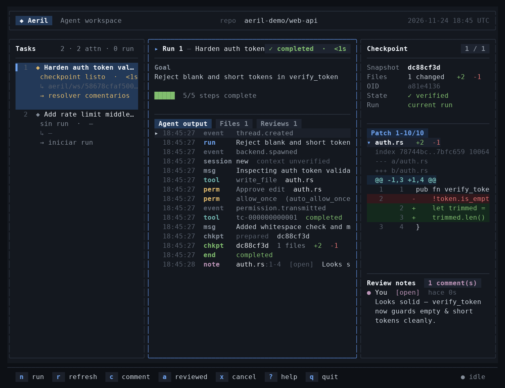

# Aeril

**A lightweight workspace for AI coding agents, right in your terminal.**

Keep track of what your AI coding assistants are doing, review what they changed, leave feedback, and pick up cleanly where you left off—without bloated editors or juggling dozens of terminal windows.

> **Built for modest hardware.** Aeril itself uses very little memory, so you can run it smoothly on a basic laptop, VM, or low-cost Linux VPS. *(Keep in mind that external AI models and agent tools have their own memory and API requirements.)*



---

## Why Aeril? (Product Overview)

Suppose you are building an app and ask an AI assistant to fix a bug. Afterward, you want to see exactly which lines changed, leave a note about something it missed, and continue the next day. Without a workspace manager, that quickly turns into scattered terminal tabs, lost progress, and guessing what the AI edited.

Aeril acts like a clean **control room** for those AI tasks:

- **One place per task:** Every task keeps its own conversation history, workspace, and saved progress—no more digging through old terminal scrollback.
- **See changes before keeping them:** Inspect what the AI modified and approve it before anything touches your main project files.
- **Give feedback and iterate:** Leave notes directly on specific changes so the AI knows what to adjust on the next pass.
- **Recover cleanly from interruptions:** If your terminal closes or your computer restarts unexpectedly, Aeril remembers where each task stopped and keeps your verified file snapshots safe.
- **Stay out of each other's way:** Prevents two sessions from accidentally editing the same workspace at once.
- **Works alongside your tools:** Your project stays a normal folder/Git repository—use whatever code editor you already prefer.

> **Important:** Aeril is **not** an AI model itself. It is the workspace that organizes and supervises external AI coding agents (such as [Hermes](docs/acp-hermes-spec.md)).

### How It Works


1. **Open a task.** Each task gets its own history, branch, and isolated Git workspace.
2. **Start an agent.** Aeril supervises the run and displays the objective, live activity, and execution status.
3. **Inspect the result.** Review the diff, modified files, and verified checkpoint before integrating anything.
4. **Leave context.** Comments and feedback remain anchored to the task and the reviewed checkpoint for follow-up runs.
5. **Resume safely.** If a session is interrupted, Aeril preserves durable evidence and recovery points without rebuilding state from dirty working-tree assumptions.

---

## Technical Capabilities

For engineers and contributors, here is how Aeril enforces those guarantees under the hood:

- **Isolated task workspaces:** Each task thread runs in its own verified Git worktree (`aeril/ws/<id>`) with an independent event log.
- **Immutable checkpoints:** Captures real working-tree diffs into Git snapshot refs (`refs/aeril/checkpoints/<id>`) via a crash-safe `prepared → ready` protocol without modifying your active branch or index.
- **Anchored code review:** Attaches line-level comments to verified checkpoints and sends structured feedback turns back to the engine.
- **Crash recovery & workspace safety:** Reconciles interrupted runs on startup without fabricating state from the current working tree, prevents concurrent Aeril writers via PID-verified advisory leases, and restricts integration to fast-forward CAS updates.
- **Low-overhead architecture:** Single static Rust binary using a synchronous `ratatui` TUI, a local SQLite WAL store, and an explicit ACP stdio client (`tokio`).

The TUI supports supervising up to two concurrent mock runs. Live Hermes execution enforces a single authenticated session at a time.

---

## Getting Started

> **Status:** Early developer preview on Linux x86_64. No system-wide installer package is published yet, and live AI runs support **one authenticated Hermes ACP session at a time**.

### Prerequisites

- Linux (x86_64) with standard GNU userspace (`glibc`, `zlib`)
- Git
- Rust & Cargo (2024 edition) to build from source (or a verified Linux release tarball)
- An external authenticated ACP agent (`hermes acp`) for live AI runs, or the built-in mock backend for local testing (`--backend mock:<script>`)

Verify `hermes` before running live AI tasks (expected output: `Hermes ACP check OK`):

```bash
hermes acp --check
```

### Build, Package & Install

**From source (reproducible release bundle):**

```bash
git clone https://github.com/elliotsecops/aeril.git
cd aeril
make package-linux
```

This builds `target/release/aeril` with `--locked`, verifies size and runtime ABI dependency budgets, and emits `dist/aeril-0.1.0-linux-x86_64.tar.gz` plus its `.sha256` checksum. Install into `~/.local/bin`:

```bash
tar -xzf dist/aeril-0.1.0-linux-x86_64.tar.gz
sha256sum -c dist/aeril-0.1.0-linux-x86_64.tar.gz.sha256
install -Dm755 aeril-0.1.0-linux-x86_64/aeril ~/.local/bin/aeril
```

*(Ensure `~/.local/bin` is on your `PATH`. Aeril stores local task state under `~/.local/share/aeril`, overridable via `AERIL_DATA_DIR`, without requiring hidden configuration files. Make sure your project `.gitignore` ignores build/bytecode caches such as `__pycache__/`, `node_modules/`, or `target/`—snapshot v0 rejects unignored binary files.)*

### Verify Installation & First Run

```bash
aeril version
aeril --help
aeril thread new --repo /path/to/your/repo --title "Fix login flow"
aeril thread list
aeril
```

Running `aeril` without arguments launches the terminal UI, where your new thread appears in the **Tasks** pane immediately. *(Creating a thread registers the task only; it does not start an agent run automatically. From CLI you can pass `--model <provider:model>` to `run start` or `feedback send` to override Hermes's default model.)*

---

## Current Status & Limitations

Aeril includes progressive verified Attention projection (`PA0-PERF-R`), contextual manual integration guidance (`PA0-C`), deterministic Linux x86_64 packaging and live authenticated single-session Hermes certification (`PA0-D`), alongside the terminal UI, durable task history, diff inspection, anchored review comments, immutable checkpoints, crash recovery, and workspace coordination. The current `main` baseline passed **357/357 Rust tests** (`35` unit + `322` integration), bit-for-bit reproducible Linux builds verified across separate directories, and release resource budgets.

Managed Hermes profile isolation (P2-S1) is also implemented, with per-agent `HERMES_HOME` isolation and single-writer locks, and remains **disabled by default** (`AERIL_HERMES_PROFILES`).

### Not Yet Supported / Out of Scope

- **Concurrent authenticated Hermes sessions:** Running two live authenticated Hermes sessions simultaneously is not supported (`P2-S2` remains on HOLD; the TUI enforces one active Hermes run at a time).
- **OS sandboxing & host credential isolation:** Aeril separates tasks and workspaces cooperatively; it is not an OS security sandbox isolating files or ambient credentials from processes running as the same user.
- **Verified conversational memory restore:** Checkpoints recover verified project state (`verified=false` on ACP `session/load` restoration), not guaranteed model memory or private reasoning.
- **Certified hardware/distro matrix:** Raspberry Pi (ARM), Android (Termux), and arbitrary VPS tiers are not certified.
- **Agent memory containment:** An external AI agent's own memory usage is independent and does not fit inside Aeril's idle memory budget.

---

## Target Environments

| Environment | Status |
|---|---|
| Linux desktop / laptop (x86_64) | Primary development and test environment |
| Linux VM | Supported (build from source) |
| Low-cost Linux VPS | Design target (external agent/model RAM and API costs are separate) |
| Raspberry Pi (ARM) | Target interest; uncertified |
| Android (Termux) | Potential future target; untested and unsupported |

---

## Architecture & Performance

- **Stack:** Rust, `ratatui` (TUI), `rusqlite` (SQLite WAL), `git2` (libgit2 worktrees/snapshots/CAS), `tokio` (per-run ACP stdio client).
- **Measured orchestrator footprint** (release build on Linux x86_64 — Intel i7-8550U, 15.4 GiB RAM, `tmpfs`, warm OS page cache; binary SHA-256 `ca2cc34262b68c00e078691bd01df9d7242ba7b74c7198c0ec3bace1af8ed0c3`):

| Metric | Measured |
|---|---:|
| Release binary size | **6,299,088 bytes** (6.3 MB) |
| Idle RSS | **10,060 KiB** (9.8 MB) |
| RSS with one thread open | **10,472 KiB** (10.2 MB) |
| Additional memory per thread | **0.4 MiB** |
| Startup latency (p95, 30 samples) | **11.82 ms** |
| TUI with two mock runs | **9,628 KiB** |
| Combined RSS, TUI + two mocks | **18,768 KiB** |
| Rust test suite | **357/357 PASS** |
| `cargo fmt` / Clippy | PASS |

*These measurements reflect a specific hardware environment and are not guaranteed minimums. Memory used by Hermes or any external agent is **not** included in Aeril's idle RSS.*

---

## Documentation

- [Private Alpha Contract (PA0)](docs/pa0-alpha-contract.md)
- [PA0-C Blocked Integration Design & Acceptance](docs/pa0-c-prep.md)
- [PA0-D Reproducible Linux & Live Hermes Evidence](docs/pa0-d-hermes-evidence.md)
- [Phase 2 TUI Acceptance & Concurrency Evidence](docs/phase2-tui-acceptance.md)
- [Manifesto & Performance Budgets](MANIFIESTO.md)
- [Engineering Handoff & Current Limits](HANDOFF.md)
- [Phase 1 Status & Verification](docs/phase1-status.md)
- [Phase 2-S1 Managed Hermes Profiles](docs/phase2-s1-implementation.md)
- [Phase 2-S1 R3 Audit Remediation](docs/phase2-s1-r3-remediation.md)
- [Hermes ACP Protocol Specification](docs/acp-hermes-spec.md)

---

**Aeril — fewer windows, more control over your agents' work.**
